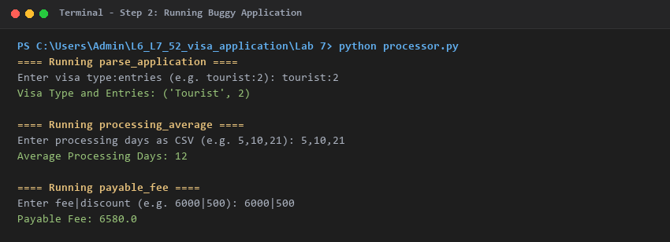
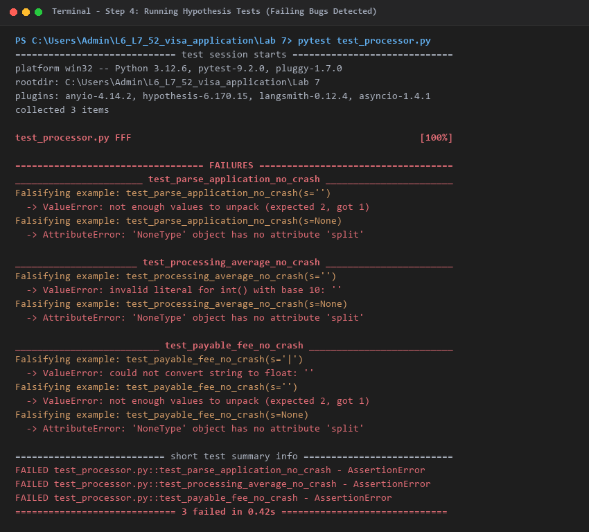
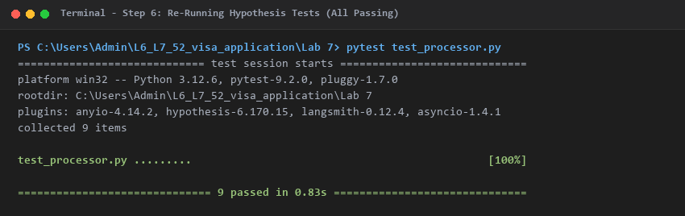

# Lab 7: Fuzzing for Input Validation Bugs

**Repository:** `L6_L7_52_visa_application`  
**Lab Component:** Lab 7  

---

## 1. Overview & Objectives

This lab explores **Fuzz Testing** as a security and quality assurance technique using Python's `Hypothesis` library.
- **Objective:** Detect and analyze bugs caused by random, unexpected, and malformed inputs, then harden the code through defensive programming.
- **Target Application:** [`visa_application.py`](visa_application.py) (aliased as [`processor.py`](processor.py))
- **Test Suite:** [`test_processor.py`](test_processor.py) (and [`test_visa_application.py`](test_visa_application.py))

Functions under test:
1. `parse_application(text)`
2. `processing_average(days_csv)`
3. `payable_fee(text)`

---

## 2. Deliverables Checklist

| Deliverable | File in Repository | Status |
|-------------|-------------------|--------|
| **1. PDF Document with Screenshots** | [`Lab7_Fuzzing_Submission_Report.pdf`](Lab7_Fuzzing_Submission_Report.pdf) | Completed |
| **2. Fixed Application Python Script** | [`visa_application.py`](visa_application.py) / [`processor.py`](processor.py) | Hardened & Tested |
| **3. Updated Test Script Code** | [`test_processor.py`](test_processor.py) / [`test_visa_application.py`](test_visa_application.py) | 9 Tests (Hypothesis + Properties) |

---

## 3. Step-by-Step Lab Execution & Findings

### Step 1: Install Dependencies
```bash
pip install hypothesis pytest
```

### Step 2: Run Buggy Application
```bash
python processor.py
```
*Output with standard valid inputs:*
```
==== Running parse_application ====
Enter visa type:entries (e.g. tourist:2): tourist:2
Visa Type and Entries: ('Tourist', 2)

==== Running processing_average ====
Enter processing days as CSV (e.g. 5,10,21): 5,10,21
Average Processing Days: 12

==== Running payable_fee ====
Enter fee|discount (e.g. 6000|500): 6000|500
Payable Fee: 6580.0
```


---

### Step 3 & 4: Hypothesis Fuzz Testing (Bugs Detected)
```bash
pytest test_processor.py
```
*Results:* Hypothesis exposed multiple unhandled exceptions across all three functions:
1. `parse_application`:
   - `s = ''` -> `ValueError: not enough values to unpack (expected 2, got 1)`
   - `s = None` -> `AttributeError: 'NoneType' object has no attribute 'split'`
2. `processing_average`:
   - `s = ''` -> `ValueError: invalid literal for int() with base 10: ''`
   - `s = None` -> `AttributeError: 'NoneType' object has no attribute 'split'`
3. `payable_fee`:
   - `s = '|'` -> `ValueError: could not convert string to float: ''`
   - `s = ''` -> `ValueError: not enough values to unpack (expected 2, got 1)`
   - `s = None` -> `AttributeError: 'NoneType' object has no attribute 'split'`



---

### Step 5: Harden & Run Fixed Application
The functions were hardened using defensive programming:
- **`parse_application`**: Validates string type and existence, verifies exactly two colon-separated segments, strips whitespace, ensures non-empty visa name, and validates non-negative integer entries (returns `None` on invalid inputs).
- **`processing_average`**: Validates string input, safely parses integer tokens while ignoring empty elements (e.g., `'1,,3'`) or non-integer tokens, discards negative values, and safely handles empty lists without `ZeroDivisionError` (returns `0`).
- **`payable_fee`**: Validates pipe delimiter, parses numeric floats, guards against `NaN` and `Infinity`, validates non-negative values, and clamps the final result to `0.0`.

```bash
python processor.py
```


---

### Step 6: Re-Run Hypothesis Fuzz Tests (All Passing)
```bash
pytest test_processor.py
```
*Output:*
```
collected 9 items

test_processor.py .........                                              [100%]

============================== 9 passed in 0.83s ==============================
```


---

## 4. How to Verify

```bash
cd "Lab 7"
pytest test_processor.py
pytest test_visa_application.py
```
